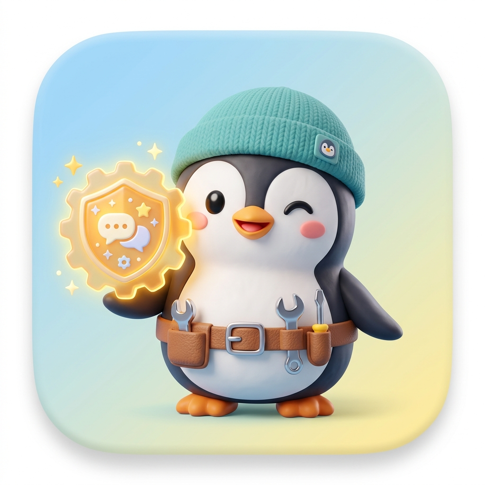

<div align="center">
  
  <h1>QQ工具集</h1>
  <h3><code>astrbot_plugin_new_qq_tools</code></h3>
  <p><b>为 AstrBot 深度打造的 QQ 平台生产力工具箱与扩展套件</b></p>

  <p>
    <a href="https://github.com/YanZephyr14/astrbot_plugin_new_qq_tools/releases"></a>
    
    
    <a href="LICENSE"></a>
    
  </p>

  <p>
    <a href="#-开源致敬与来源">开源声明</a> •
    <a href="#-核心特性">核心特性</a> •
    <a href="#-安装部署">安装部署</a> •
    <a href="#-工具清单">工具清单</a> •
    <a href="#-实战对话示例">对话示例</a> •
    <a href="#️-配置指南">配置指南</a> •
    <a href="#-常见问题-faq">常见问题</a>
  </p>
</div>

---

> ### 📢 开源致敬与来源
>
> 本项目基于原作者 [**@YUMU1658**](https://github.com/YUMU1658) 的开源项目 [astrbot_plugin_qq_tools](https://github.com/YUMU1658/astrbot_plugin_qq_tools) 接续维护与演进开发。
>
> 因原作者仓库已正式归档（Archived），为保障广大 AstrBot 用户在 QQNT 生态下的长期可用性与日常会话稳定，本项目以 **`astrbot_plugin_new_qq_tools`**（中文名：**QQ工具集**）接力发布与迭代，重点解决了底层协议无载荷空事件诱发的模型幻觉与异常调用问题，并持续优化架构与兼容性。衷心感谢原作者 [@YUMU1658](https://github.com/YUMU1658) 优秀的架构设计与无私开源贡献！

---

## 💡 为什么需要本插件？

AstrBot 拥有强大的多平台与 Agent 对话能力，但在面对 QQ（NapCat / aiocqhttp）特有的交互场景时，机器人往往需要更细粒度的“动手”能力：

* **引用回复太生硬？** 本插件支持无缝引用回复语法，LLM 生成文本时直接挂载目标消息引用，无需额外的工具调用轮次。
* **空消息导致机器人自言自语？** QQNT 文件回执等无载荷底层事件可能被包装为伪文本，导致模型产生严重幻觉。本插件内置双重防线，底层自动静默阻断。
* **想撤回/查上下文/管群聊？** 提供了一整套专为 QQ 打造的原子化工具，让大模型能精准撤回指定消息、调阅群聊天记录、禁言违规成员或自动定时唤醒。

---

## ✨ 核心特性

```
                       ┌── 💬 引用回复适配器（纯文本原生转 Reply 组件）
                       ├── 🛡️ 空事件拦截守卫（根除 QQNT 状态回执引发的幻觉）
                       ├── 🎯 消息与上下文管理（精准撤回 / 消息回溯 / 消息详情）
QQ工具集 (QQ Tools) ───┼── 👥 群管与互动（禁言 / 踢人 / 头衔 / 公告 / 精华 / 戳一戳）
                       ├── 🖼️ 视觉与多媒体（高清头像提取 / 注入视觉上下文）
                       ├── 🌐 网页视觉交互（Playwright + 自动红标 / 网格辅助点击）
                       ├── 🎬 视频智能分析（Gemini 解析 B站 / QQ 视频消息）
                       └── ⏰ 会话级延迟唤醒（自动触发原会话后续工作流）
```

1. **💬 轻量级引用回复适配器**
   - 模型在输出中自然写出 `[REPLY:消息ID]回复文本`，插件自动将其转换为 QQ 原生 Reply 组件。
   - 不接管分段发送，零侵入无副作用；可自定义注入 System Prompt 引导词。
2. **🛡️ 纯净守卫与防幻觉机制**
   - 底层监听拦截 QQNT 文件接收回执等纯空消息事件（`message: []`），调用 `event.stop_event()` 彻底静默。
   - 针对 `show_message_id` 增加 `has_content` 前置检查，杜绝向空事件硬塞标记而误唤醒模型。
3. **🎯 消息操作与上下文增强**
   - **精准撤回**：支持撤回机器人自身或群内指定用户的违规消息（带权限与 2 分钟时效校验）。
   - **消息检索与回溯**：从缓存或 API 实时拉取群内最近聊天历史，赋予模型“看上文”的能力。
   - **消息详情查看**：提取复杂消息段结构并自动将其中图片注入视觉上下文。
4. **👥 全能群管与用户互动**
   - 群禁言、全体禁言、踢人、群名片修改、发布群公告、设精华消息、专属头衔设置。
   - 内置 AstrBot 内部黑名单（支持设置过期时间自动解除）。
   - QQ 个人信息查询、双向“戳一戳”互动。
5. **🌐 视觉化网页浏览（基于 Playwright）**
   - 自动生成带红色数字标记的页面截图并注入大模型视觉上下文。
   - 独创**网格坐标辅助定位**（`browser_grid_overlay` 与 `browser_click_relative`），即使 Canvas 或无标记元素也能精准点击。
   - 内置严格的 **SSRF 防御**（默认禁止访问私有内网、支持白名单/黑名单域名）。
6. **🎬 视频智能分析（基于 Gemini）**
   - 一键解析 B 站视频（支持 BV 号、av 号、b23.tv 短链、分享文本）及 QQ 聊天中的视频消息。
7. **⏰ 会话级定时唤醒（Wake Scheduler）**
   - LLM 能够在当前会话创建“延迟 N 秒后唤醒”的提醒或延续任务，到期自动在原会话唤醒并继续跟进。

---

## 📦 安装部署

### 方式 1：WebUI 插件市场（推荐）
1. 打开 AstrBot 管理面板 WebUI ➔ 进入「插件」/「插件市场」；
2. 搜索 **`QQ工具集`** 或 **`astrbot_plugin_new_qq_tools`**；
3. 点击「安装」，安装完成后按需开启相关配置即可。

### 方式 2：CLI 命令行安装
在 AstrBot 运行目录下执行：
```bash
astrbot plug install astrbot_plugin_new_qq_tools
```

### 方式 3：Git 手动克隆
进入 AstrBot 的插件目录 `data/plugins/`：
```bash
cd data/plugins
git clone https://github.com/YanZephyr14/astrbot_plugin_new_qq_tools.git
```

### 🧩 可选功能依赖安装
如果你计划使用**网页浏览**或**视频分析**功能，请在 AstrBot 环境中补充安装对应依赖：
```bash
# 网页浏览所需依赖
pip install playwright Pillow
playwright install chromium

# 视频分析无需额外库，只需在配置中填写 Gemini API Key
```

---

## 🧰 工具清单

> 💡 **提示**：所有工具均为 LLM 可调用的原生 Tool。在 QQ 里只需用自然语言发送指令，模型便会自动理解并决策是否调用工具。  
> 若开启了 `advanced.compatibility.add_tool_prefix=true`，工具名称将自动统一追加 `qts_` 前缀（如 `qts_delete_message`），防止与其他插件重名冲突。

### 1. 基础消息与上下文
| 工具名 | 说明 | 典型用户指令 |
|---|---|---|
| `get_recent_messages` | 获取最近消息列表（补齐上下文） | *“帮我看看刚才大家在群里聊了什么”* |
| `refresh_messages` | 主动刷新最近消息列表 | *“再刷新拉取一下最新消息”* |
| `repeat_message` | 复读 / 转发指定消息 | *“把他刚才那条消息原样复述出来”* |
| `delete_message` | 撤回（删除）一条或多条消息 | *“把刚才那条消息撤回”* |
| `stop_conversation` | 结束/中止当前连续对话流程 | *“停止本次任务” / “结束当前会话”* |
| `get_message_detail` | 获取消息详细数据（可注入大图） | *“这条消息里发了什么？把图片调出来看看”* |
| `get_group_member_list` | 获取群成员详细列表 | *“群里现在都有哪些人在？列一下名单”* |

### 2. QQ 资料与群务管理
| 工具名 | 说明 | 典型用户指令 |
|---|---|---|
| `get_user_info` | 查询指定用户的公开资料 | *“查一下 @张三 的个人资料”* |
| `poke_user` | 在群内或私聊中戳一戳指定用户 | *“去戳一下 @李四”* |
| `view_qq_avatar` | 获取指定用户的高清头像并分析 | *“看看群主的头像长什么样”* |
| `change_group_card` | 修改指定群成员的群名片 | *“把我的群名片改成『前端-小王』”* |
| `group_ban` | 对指定群成员禁言指定时长 | *“把刚才发广告的禁言 10 分钟”* |
| `group_mute_all` | 开启或关闭全员禁言 | *“全员禁言” / “解除全员禁言”* |
| `kick_user` | 将指定成员移出群聊 | *“把这个人移出群聊”* |
| `send_group_notice` | 发布群公告 | *“发一个公告：今晚 8 点群内举行活动”* |
| `set_essence_message` | 将指定消息设为群精华消息 | *“把上面这条攻略设为群精华”* |
| `set_special_title` | 设置成员专属头衔（需群主身份） | *“给 @王五 设置头衔『摸鱼大师』”* |
| `ban_user` | 加入 AstrBot 内部临时/长期黑名单 | *“拉黑这个人 1 小时，不响应其指令”* |

### 3. 网页视觉浏览（需启用 `browser_config.browser=true`）
| 工具名 | 说明 |
|---|---|
| `browser_open` | 打开目标 URL，渲染并回传带红色数字标记的页面截图（注入模型视觉感知） |
| `browser_click` | 根据标记数字直接点击对应交互元素 |
| `browser_grid_overlay` | **点位辅助**：在截图上叠加精准坐标网格（解决无标注/Canvas元素交互问题） |
| `browser_click_relative` | **相对点击**：配合网格辅助线，在页面相对百分比坐标处触发点击 |
| `browser_click_in_element` | 在复杂元素（SVG/Canvas）内执行局部相对位置点击 |
| `browser_input` | 聚焦输入框并录入指定文字 |
| `browser_scroll` | 页面向下/向上滚动指定像素 |
| `browser_wait` | 等待指定毫秒数以加载动态内容 |
| `browser_get_link` | 提取页面中指定数字标记的原始超链接 |
| `browser_view_image` | 抓取网页中指定图片注入模型上下文观察 |
| `browser_crop` | 局部裁剪放大页面截图，看清小字或验证码 |
| `browser_screenshot` | 拍摄当前页面无标记的原版高清截图直接发送到 QQ 群/私聊 |
| `browser_close` | 主动结束并关闭当前浏览器会话 |

### 4. 视频分析与定时任务
| 工具名 | 说明 | 典型用户指令 |
|---|---|---|
| `view_video` | 解析并总结 B 站视频或 QQ 视频内容 | *“总结一下这个 B 站视频：BV1xxxxxx”* |
| `schedule` | 在当前会话创建延迟唤醒任务 | *“20 分钟后在群里提醒我去开会”* |
| `manage_wake` | 查看、取消或清空当前会话的唤醒队列 | *“查看我定过的提醒” / “取消所有提醒”* |

---

## 🧪 实战对话示例

<details>
<summary><b>1. 引用回复适配（无需额外工具调用）</b></summary>

启用 `reply_adapter.enable=true` 后，模型在普通回答中即可引用上下文：
```text
[REPLY:198273645]针对你的这个问题，解决方案如下：
首先检查网络配置，然后重启服务即可。
```
插件在底层会自动将该标签转化为 QQ 原生 Reply 组件，在手机 QQ / PC QQ 上呈现标准的引用小框。
</details>

<details>
<summary><b>2. 消息精准撤回</b></summary>

* **用户**：“把刚刚发的那张图撤回一下。”
* **机器人**：（自动读取前序消息提取 message_id ➔ 调用 `delete_message` ➔ 撤回成功）“已为你撤回刚才发送的图片。”
</details>

<details>
<summary><b>3. 群上下文追溯与总结</b></summary>

* **用户**：“刚才群里讨论了什么内容？帮我做个三句话摘要。”
* **机器人**：（调用 `get_recent_messages` 获取最近 30 条消息 ➔ 分析提炼）“刚才大家主要讨论了三个要点：1. 周末活动时间定在周六；2. 聚餐地点推荐了西溪天街；3. 预算人均 100 元。”
</details>

<details>
<summary><b>4. 自动化网页浏览与查询</b></summary>

* **用户**：“打开 https://github.com/trending ，告诉我今天最热门的 Python 仓库是哪一个。”
* **机器人**：（调用 `browser_open` ➔ 模型观察页面视觉标注 ➔ 识别第一名 ➔ 调用 `browser_close`）“今日 Trending 排名第一的 Python 仓库是 xxx，主要用于...”
</details>

---

## ⚙️ 配置指南

插件提供完整的 WebUI 配置面板，可在 AstrBot 后台「插件配置」中可视化调整：

| 配置分类 | 核心配置项 | 默认值 | 说明与建议 |
|---|---|---|---|
| **引用回复** (`reply_adapter`) | `enable` | `false` | 是否开启引用回复语法转换。建议启用以获得原生体验。 |
| | `prompt` | 内置引导语 | 注入到模型 System Prompt 的提示引导，留空则不注入。 |
| **上下文增强** (`context_enhance`) | `show_message_id` | `false` | 发送消息时在末尾附加 `[MSG_ID:xxxx]`，方便模型精准引用与撤回。 |
| **群管权限** (`tool_permission`) | `admin_only_tools` | `["group_ban", ...]` | 限制仅允许管理员或群主调用的工具名单，防止群员滥用。 |
| **浏览器配置** (`browser_config`) | `browser` | `false` | 网页浏览开关。开启前需确认已安装 Playwright 与 Chromium。 |
| | `allow_private_network`| `false` | **SSRF 防御**：是否允许访问内网 IP。严禁在公开群聊开启！ |
| | `allowed_domains` | `[]` | 允许访问的域名白名单，为空表示不限制（黑名单除外）。 |
| | `blocked_domains` | `["*.internal"]` | 强制阻断访问的高危域名黑名单。 |
| **视频分析** (`gemini_video_config`)| `view_video` | `false` | 视频智能分析开关。 |
| | `api_key` | `""` | Google Gemini API Key（支持官方免费 Key）。 |
| **高级兼容** (`advanced`) | `add_tool_prefix` | `false` | 为所有工具统一增加 `qts_` 前缀，解决多插件重名冲突。 |

---

## 🔐 权限与安全建议

1. **高风险工具默认受控**：群禁言、踢人、全体禁言、消息撤回等均有实际副作用，建议在 `tool_permission` 中严格限制操作者权限。
2. **严防 SSRF 内网穿透**：
   - 网页浏览工具 `browser_open` 能够访问外网网页，**务必保持 `allow_private_network: false`**；
   - 杜绝通过机器人请求 `127.0.0.1`、`192.168.x.x` 或宿主机敏感管理面板。

---

## 🧩 兼容性说明

| 适配器类型 | 兼容程度 | 说明 |
|---|:---:|---|
| **aiocqhttp (NapCat)** | 🟢 **100% 完美支持** | 本项目原生开发与持续测试基准平台。 |
| **aiocqhttp (Lagrange / LLOneBot)** | 🟡 **良好 (90%+)** | 基础消息、撤回、群管均通用；个别非标准扩展字段可能略有差异。 |
| **官方 QQ Bot (qq_official)** | 🔴 **仅部分基础功能** | 官方机器人 API 限制较多，不支持撤回非自身消息、不可直接取 raw message_id。 |
| **Telegram / 微信 / 开黑啦** | ⚪ **不推荐** | 本插件 90% 以上逻辑专为 QQ 消息结构深度定制。 |

---

## 🆘 常见问题 (FAQ)

<details>
<summary><b>Q1: 为什么执行撤回提示失败？</b></summary>

- QQ/OneBot 协议规定，**普通成员仅能在发送后 2 分钟内撤回**自己发出的消息；
- 若机器人撤回群内其他成员的消息，**机器人账号必须拥有群管理员或群主身份**；
- 某些协议实现（如特定版本的 QQNT 核心）对旧消息 ID 返回格式不一致，本插件内置了多层适配逻辑，但仍受限于底层实现。
</details>

<details>
<summary><b>Q2: 模型有时候“记不住”或者“找不到”刚才的消息 ID？</b></summary>

- 可以在配置中开启 `context_enhance.show_message_id=true`；
- 或者直接让模型调用 `get_recent_messages` 重新拉取一次带有明确 `message_id` 的聊天历史。
</details>

<details>
<summary><b>Q3: 网页浏览功能报错或缺少 Chromium？</b></summary>

请在运行环境中执行：
```bash
pip install playwright Pillow
playwright install chromium
```
如果处于无头 Linux 服务器中，可能还需要安装基础渲染依赖：`playwright install-deps`。
</details>

<details>
<summary><b>Q4: 为什么会遇到空消息误触发？v0.2.2 是如何修复的？</b></summary>

在 QQNT（如 NapCat）中，用户点击文件下载回执或特定卡片时，协议端会下发消息内容为空的底层事件。以往因无条件注入 `[MSG_ID]` 导致空事件被当作常规文本交给 LLM，诱发大模型幻觉自言自语。**v0.2.2 在最外层进行了纯空事件静默阻断**，并在标记注入前加入了内容存在性校验，彻底解决了该顽疾。
</details>

---

## 🤝 参与贡献

欢迎提交 Issue 或 Pull Request！在反馈问题或建议时，烦请附带：
1. AstrBot 核心版本与运行环境（操作系统、Python 版本）；
2. 所使用的适配器类型（如 NapCat 4.x / aiocqhttp）；
3. 相关复现步骤、脱敏后的日志片段及消息示例。

---

## 🙏 开源致谢与来源

* **原作者与源项目**：[YUMU1658/astrbot_plugin_qq_tools](https://github.com/YUMU1658/astrbot_plugin_qq_tools)（原作者：[@YUMU1658](https://github.com/YUMU1658)）
* **当前维护仓库**：[YanZephyr14/astrbot_plugin_new_qq_tools](https://github.com/YanZephyr14/astrbot_plugin_new_qq_tools)（维护者：[@YanZephyr14](https://github.com/YanZephyr14)）
* **开源许可证**：本项目遵循 [MIT License](LICENSE) 继承原项目开源协议，保留原作者版权信息并在此致以崇高敬意。